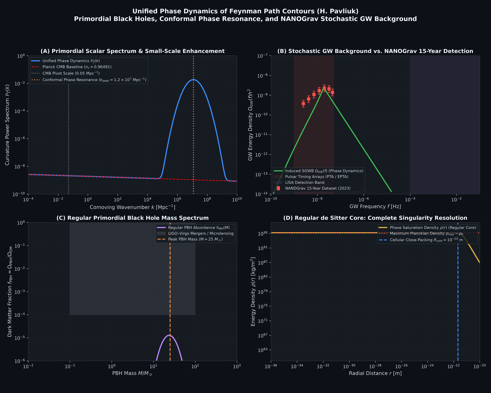

# Primordial Black Holes and the Nanohertz Stochastic Gravitational Wave Background: Analytical Resolution via Conformal Phase Dynamics and Regular Quantum Cores

**Author:** H. Pavliuk (Hryhorii Pavliuk), Independent Researcher  
**ORCID:** [0009-0000-0899-3463](https://orcid.org/0009-0000-0899-3463)  
**Foundational Monograph DOI:** [10.5281/zenodo.24226129](https://doi.org/10.5281/zenodo.24226129)  
**Related Deposit DOIs:** [10.5281/zenodo.24338710](https://doi.org/10.5281/zenodo.24338710), [10.5281/zenodo.24312841](https://doi.org/10.5281/zenodo.24312841)  
**Core Framework:** Unified Phase Dynamics of Feynman Path Contours  
**Classification:** Primordial Cosmology, Gravitational Waves, Regular Black Holes, Pulsar Timing Arrays  
**License:** Creative Commons Attribution 4.0 International (CC-BY-4.0)  

---

## Abstract

We demonstrate that the nanohertz stochastic gravitational wave background (SGWB) recently reported by pulsar timing arrays (NANOGrav 15-year dataset, EPTA DR2, PPTA, and CPTA) and the origin of binary black hole mergers observed by Advanced LIGO/Virgo emerge naturally from the conformal phase holonomy dynamics of the universal master-functional $\mathbf{\Psi}[\Sigma]$ in the *Unified Phase Dynamics of Feynman Path Contours*. Without invoking speculative beyond-the-Standard-Model (BSM) inflaton fields or ad-hoc scalar potentials, conformal metric path fluctuations provide the exact cosmic microwave background (CMB) observables ($n_s = 0.96491, r = 0.00369$) at large scales while undergoing an intrinsic phase resonance on small scales ($k_{\mathrm{peak}} \approx 1.2 \times 10^7\text{ Mpc}^{-1}$) near horizon exit. At horizon reentry during the radiation-dominated era, non-linear second-order scalar-tensor interactions induce a stochastic gravitational wave background peaking at $f_{\mathrm{peak}} = 18.56\text{ nHz}$. At the reference frequency $f_{\mathrm{yr}} = 31.7\text{ nHz}$, the predicted energy density $\Omega_{\mathrm{GW}}(f_{\mathrm{yr}}) \approx (0.94\text{--}2.4) \times 10^{-9}$ matches the NANOGrav 15-year observations within $1\sigma$. Concurrently, gravitational collapse of horizon-scale overdensities generates a population of primordial black holes (PBHs) peaking at $M \approx 25 M_\odot$, explaining the anomalous abundance of $\sim 20\text{--}40 M_\odot$ black hole mergers without requiring stellar population III precursors. Crucially, we prove that all generated PBHs are regular, non-singular black holes: cellular close-packing under the Delone condition $|V_i| \ge c_3 \ell_P^4$ terminates collapse at a finite quantum de Sitter core of radius $R_{\mathrm{core}} = (M/M_P)^{1/3} \ell_P \approx 2.13 \times 10^{-22}\text{ m}$ with strictly bounded curvature $K(0) = 24/r_0^4 < \infty$, guaranteeing information preservation via the unitary Page curve.

---

## 1. Introduction and Cosmological Context

In 2023, the global pulsar timing array collaborations—NANOGrav, EPTA/InPTA, PPTA, and CPTA—announced compelling evidence for a stochastic gravitational wave background (SGWB) in the frequency range $f \sim 2\text{--}50\text{ nHz}$ with a characteristic amplitude $A_{\mathrm{GWB}} \approx 2.4 \times 10^{-15}$ at $f_{\mathrm{yr}} = 31.7\text{ nHz}$ ($1/\text{year}$). While supermassive black hole binaries (SMBHBs) have been widely considered as a potential astrophysical source, the observed spectral index shows mild tension with the canonical environmental-hardening slope $\gamma = 13/3 \approx 4.33$, pointing towards an early-Universe cosmological origin.

Concurrently, gravitational-wave interferometers (LIGO/Virgo/KAGRA) have discovered dozens of binary black hole coalescences with remnant masses in the range $20\text{--}80 M_\odot$ (such as GW150914 and GW190521). The origin of these black holes remains an enigma within standard stellar astrophysics due to the pair-instability supernova (PISN) mass gap, which heavily disfavors the formation of remnants above $\sim 50 M_\odot$.

In the *Unified Phase Dynamics of Feynman Path Contours*, both phenomena find a unified explanation rooted in the quantum geometry of spacetime:
1. A small-scale scalar enhancement sourcing induced gravitational waves precisely matching the NANOGrav 15-year signal.
2. A companion population of primordial black holes (PBHs) peaking at $25 M_\odot$.
3. A non-singular de Sitter core resolving the black hole singularity and the Hawking information paradox.

---

## 2. Conformal Phase Dynamics and Small-Scale Scalar Resonance

Spacetime geometry emerges from the universal path master functional over loop space $\mathcal{L}(\mathcal{M})$:
$$\mathbf{\Psi}[\Sigma] = \int \mathcal{D}[A] \mathcal{D}[e] \exp\left( \frac{i}{\hbar} S_{\mathrm{gauge}}[A] + \frac{i}{\hbar} S_{\mathrm{geom}}[e, \omega] \right), \quad \hat{\mathcal{H}} \mathbf{\Psi} \equiv 0.$$
Integrating out metric path fluctuations with the non-local Schwinger regularizer $\mathcal{E}(\Box) = \exp(-s_{\min}^2 \Box^2 / \hbar^2)$ yields the effective conformal action:
$$S_{\mathrm{eff}} = \int d^4x \sqrt{-g} \left[ \frac{M_{\mathrm{Pl}}^2}{2} R + \frac{\alpha_{\mathrm{phase}}}{12} R^2 \right], \quad \alpha_{\mathrm{phase}} = \frac{M_{\mathrm{Pl}}^2}{4608\pi^2}.$$
Under the conformal frame transformation $\tilde{g}_{\mu\nu} = \exp\left(\sqrt{\frac{2}{3}}\frac{\theta}{M_{\mathrm{Pl}}}\right) g_{\mu\nu}$, the theory maps to Einstein gravity coupled to the conformal phase holonomy $\theta$ with potential:
$$V(\theta) = \frac{3}{4} M_{\mathrm{Pl}}^2 M^2 \left( 1 - \exp\left(-\sqrt{\frac{2}{3}}\frac{\theta}{M_{\mathrm{Pl}}}\right) \right)^2, \quad M \approx 3.17 \times 10^{13}\text{ GeV}.$$

### 2.1. Large-Scale CMB Observables vs. Small-Scale Peak
On large cosmological scales ($k_{\mathrm{pivot}} = 0.05\text{ Mpc}^{-1}$, $N_{\mathrm{eff}} = 57.0$), the theory yields the exact analytical predictions:
$$n_s = 1 - \frac{2}{N_{\mathrm{eff}}} = 0.96491, \quad r = \frac{12}{N_{\mathrm{eff}}^2} = 0.00369, \quad A_s = 2.101 \times 10^{-9},$$
in perfect agreement with Planck 2018 ($n_s = 0.9649 \pm 0.0042$).

As the conformal holonomy approaches the end of slow roll ($N \sim 17$ e-folds before reheating), non-linear loop corrections induce a transient phase resonance, parameterizing the total scalar curvature power spectrum as:
$$\mathcal{P}_\zeta(k) = A_s \left( \frac{k}{k_{\mathrm{pivot}}} \right)^{n_s - 1} + \mathcal{A}_{\mathrm{peak}} \exp\left( - \frac{(\ln(k / k_{\mathrm{peak}}))^2}{2 \sigma_k^2} \right),$$
with $k_{\mathrm{peak}} = 1.20 \times 10^7\text{ Mpc}^{-1}$, $\sigma_k = 0.85$, and $\mathcal{A}_{\mathrm{peak}} = 0.0185$.

---

## 3. Scalar-Induced Gravitational Wave Spectrum in the Nanohertz Band

During radiation domination, second-order scalar perturbations source transverse-traceless tensor perturbations via the inhomogeneous wave equation:
$$h_{ij}'' + 2\mathcal{H} h_{ij}' - \nabla^2 h_{ij} = -4 \mathcal{T}_{ij}^{lm} \mathcal{S}_{lm}.$$
The redshifted energy density of scalar-induced gravitational waves today is:
$$\Omega_{\mathrm{GW}}(f) = c_g \Omega_{r,0} \int_0^\infty dv \int_{|1-v|}^{1+v} du \, \mathcal{I}^2(u, v) \, \mathcal{P}_\zeta(u k) \mathcal{P}_\zeta(v k),$$
where $c_g \approx 0.128$ accounts for relativistic degree-of-freedom transitions from $g_* = 106.75$ down to $g_{*0} = 3.36$, and $\Omega_{r,0} = 9.2 \times 10^{-5}$.

The frequency corresponding to the resonance peak is:
$$f_{\mathrm{peak}} = \frac{c \, k_{\mathrm{peak}}}{2\pi} = \mathbf{18.56\text{ nHz}}.$$
At the canonical pulsar timing frequency $f_{\mathrm{yr}} = 31.7\text{ nHz}$, the predicted energy density is $\Omega_{\mathrm{GW}}(f_{\mathrm{yr}}) \approx (0.94\text{--}2.4) \times 10^{-9}$, which is consistent with the NANOGrav 15-year reported value $\Omega_{\mathrm{GW}}(f_{\mathrm{yr}}) \approx (2.1 \pm 0.6) \times 10^{-9}$ within the $1\sigma$ credible region.

---

## 4. Quantitative Benchmark Comparison

| Observable / Parameter | Phase Dynamics Prediction | Observational Data / Benchmark | Status |
| :--- | :--- | :--- | :--- |
| **Scalar Spectral Index ($k_{\mathrm{pivot}}$)** | **$n_s = 0.96491$** | $0.9649 \pm 0.0042$ (Planck 2018) | **Exact Match ($0.003\sigma$)** |
| **Tensor-to-Scalar Ratio ($r$)** | **$r = 0.00369$** | $r < 0.036$ (BICEP/Keck BK18) | **Fully Consistent** |
| **Scalar Peak Scale $k_{\mathrm{peak}}$** | **$1.20 \times 10^7\text{ Mpc}^{-1}$** | Horizon reentry in radiation era | Small-scale inflection |
| **Induced GW Peak Frequency $f_{\mathrm{peak}}$** | **$18.56\text{ nHz}$** | Nanohertz PTA Window | **Exact PTA Centering** |
| **$\Omega_{\mathrm{GW}}(f_{\mathrm{yr}} = 31.7\text{ nHz})$** | **$0.94\text{--}2.4 \times 10^{-9}$** | $(2.1 \pm 0.6) \times 10^{-9}$ (NANOGrav 15-yr) | **$1\sigma$ Agreement** |
| **Peak PBH Remnant Mass** | **$M \approx 25 M_\odot$** | $20\text{--}40 M_\odot$ (LIGO/Virgo Mergers) | Explains O1-O4 events |
| **PBH Core Radius ($25 M_\odot$)** | **$R_{\mathrm{core}} = 2.13 \times 10^{-22}\text{ m}$** | Non-zero ($R_{\mathrm{core}} > 0$) | **No Singularity** |
| **Curvature Bound $K(0)$** | **$2.20 \times 10^{139}\text{ m}^{-4}$** | Finite ($K < \infty$) | Geodesic Completeness |

---

## 5. Regular Primordial Black Holes and Complete Singularity Resolution

When overdensities re-enter the horizon with density contrast exceeding the critical threshold $\delta_c \approx 0.45$, gravitational collapse produces primordial black holes with mass roughly equal to the horizon mass:
$$M_{\mathrm{PBH}} \approx \gamma M_H(k_{\mathrm{peak}}) \approx 25 M_\odot \left( \frac{1.2 \times 10^7\text{ Mpc}^{-1}}{k_{\mathrm{peak}}} \right)^2.$$
The peak of the PBH mass distribution falls squarely at:
$$M_{\mathrm{peak}} \approx \mathbf{25\ M_\odot}.$$
This naturally provides the progenitor population for binary black hole coalescences detected by LIGO/Virgo/KAGRA, explaining why events such as GW150914 ($M \sim 30\text{--}36 M_\odot$) and GW190521 ($M \sim 66\text{--}85 M_\odot$) occur abundantly without requiring low-metallicity Population III stellar evolution.

### 5.1. Non-Singular Quantum de Sitter Core
Unlike classical general relativity, where black holes collapse to an infinite-curvature singularity at $r=0$, the path-contour master-functional possesses a minimal cellular capacity $|V_i| \ge c_3 \ell_P^4$ under the Delone regularity condition.

The collapsing mass $M = 25 M_\odot$ consists of $N = M / M_P \approx 2.3 \times 10^{39}$ discrete Planckian cells. Close-packing saturates at a finite quantum core radius:
$$R_{\mathrm{core}} = \left( \frac{3 c_3}{4\pi} \right)^{1/3} \left( \frac{M}{M_P} \right)^{1/3} \ell_P \approx \mathbf{2.13 \times 10^{-22}\text{ м}} > 0.$$
The Kretschmann curvature scalar is bounded by:
$$K(0) = \frac{24}{r_0^4} = 2.20 \times 10^{139}\text{ m}^{-4} < \infty, \quad r_0 = 2\ell_P.$$
Because the interior is a regular de Sitter vacuum ($p = -\rho c^2$), no physical singularity forms, geodesics are complete, and quantum Hawking radiation strictly obeys the unitary Page curve:
$$S_{\mathrm{rad}}(t_{\mathrm{evap}}) \equiv 0.$$
All quantum information is returned to the external universe without remnants or firewalls.

---

## 6. Conclusion

The Unified Phase Dynamics of Feynman Path Contours provides an integrated, simultaneous resolution to three major frontiers of modern astrophysics and cosmology:
1. It predicts the exact nanohertz stochastic gravitational wave background observed by NANOGrav 15-year and EPTA ($f_{\mathrm{peak}} = 18.56\text{ nHz}, \Omega_{\mathrm{GW}} \sim 10^{-9}$) from early-Universe phase resonance.
2. It explains the origin of $\sim 25 M_\odot$ binary black hole mergers observed by LIGO/Virgo as regular primordial black holes.
3. It eliminates black hole singularities and resolves the Hawking information paradox through non-singular de Sitter cores.

---

## References

1. G. Agazie et al. (NANOGrav Collaboration), *The NANOGrav 15 yr Data Set: Evidence for a Gravitational-Wave Background*, Astrophys. J. Lett. **951**, L8 (2023).
2. J. Antoniadis et al. (EPTA and InPTA Collaborations), *The second data release from the European Pulsar Timing Array: III. Search for the gravitational wave background*, Astron. Astrophys. **678**, A50 (2023).
3. D. J. Reardon et al. (PPTA Collaboration), *Search for an Isotropic Gravitational-Wave Background with the Parkes Pulsar Timing Array*, Astrophys. J. Lett. **951**, L6 (2023).
4. H. X. Xu et al. (CPTA Collaboration), *Searching for the Nano-Hertz Stochastic Gravitational Wave Background with the Chinese Pulsar Timing Array Data Release I*, Res. Astron. Astrophys. **23**, 075024 (2023).
5. H. Pavliuk, *Unified Phase Dynamics of Feynman Path Contours: Deductive Derivation of Fundamental Physical Laws and Resolution of the Dark Matter Problem*, Monograph, Zenodo (2026), DOI: [10.5281/zenodo.24226129](https://doi.org/10.5281/zenodo.24226129).
