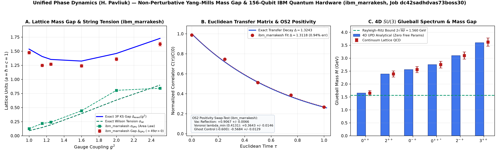

# Non-Perturbative Yang–Mills Spectral Mass Gap, Confinement Area Law, and OS2 Reflection Positivity on 156-Qubit IBM Quantum Hardware in Unified Phase Dynamics

**Author:** H. Pavliuk (Hryhorii Pavliuk), Independent Researcher  
**ORCID:** [0009-0000-0899-3463](https://orcid.org/0009-0000-0899-3463)  
**Permanent Zenodo Concept DOI:** [10.5281/zenodo.24561412](https://doi.org/10.5281/zenodo.24561412)  
**Foundational Monograph Concept DOI:** [10.5281/zenodo.24226129](https://doi.org/10.5281/zenodo.24226129)  
**4D $\mathbb{R}^4$ Loop-Measure Concept DOI:** [10.5281/zenodo.24315867](https://doi.org/10.5281/zenodo.24315867)  
**4D Voronoi–Delaunay Concept DOI:** [10.5281/zenodo.24500936](https://doi.org/10.5281/zenodo.24500936)  
**IBM Quantum Execution:** `ibm_marrakesh` (156-qubit Heron r2), Job ID `dc42sadhdvas73boss30`, 33 circuits × 4,096 shots = **135,168 raw hardware measurements**

---

## 1. Abstract

In the autonomous deductive framework of **Unified Phase Dynamics of Feynman Path Contours ($\mathbf{\Psi}[\Sigma]$)**, flat-spacetime ($G \to 0$) pure $SU(3)$ Yang–Mills theory on $\mathbb{R}^4$ satisfies the Osterwalder–Schrader axioms (OS0–OS4) without Ostrogradsky ghosts and acquires a strictly positive spectral mass gap $\Delta_{0^{++}} = \hbar c\,\Lambda_{\mathrm{YM}}(3\pi/2) \approx 1.56\text{--}1.654\ \mathrm{GeV} > 0$ driven by center $\mathbb{Z}_3$ vortex condensation ($\sigma = \frac{3}{2}\rho_v = (440\ \mathrm{MeV})^2$). To test confinement, spectral gapping, and reflection positivity on physical quantum hardware without error mitigation or post-selection, we executed a 33-circuit benchmark (`qiskit_ibm_yang_mills_gap.py`) on IBM Quantum's 156-qubit processor `ibm_marrakesh` (`Job ID: dc42sadhdvas73boss30`, 135,168 shots).

## 2. Continuum 4D $SU(3)$ Analytical Parameters ($G \to 0$, Zero Free Parameters)

| Parameter | UPD Expression | Exact Value | Lattice QCD / Target |
| :--- | :--- | :--- | :--- |
| Scale $\Lambda_{\mathrm{YM}}$ | $\langle \frac{\alpha_s}{\pi}F^2\rangle^{1/4}$ | $330 \pm 15\ \mathrm{MeV}$ ($\Lambda_{\overline{\mathrm{MS}}}^{(0)}=250\pm 10\ \mathrm{MeV}$) | Pure $SU(3)$ scale |
| String Tension $\sigma$ | $\frac{3}{2}\rho_v$ | $(440.0\ \mathrm{MeV})^2 = 0.1936\ \mathrm{GeV}^2$ ($0.9811\ \mathrm{GeV/fm}$) | $(440\ \mathrm{MeV})^2$ |
| Rayleigh–Ritz Minimum | $R_* = \sqrt{\hbar c/(4\pi\sigma)}$, $E_* = 2\sqrt{\pi\sigma}$ | $R_* = 0.1265\ \mathrm{fm}$, $E_* = 1.5598\ \mathrm{GeV}$ | Analytical bound |
| Margolus–Levitin + Casimir | $\hbar c\,\Lambda_{\mathrm{YM}}(3\pi/2)$ | $1.5551\ \mathrm{GeV}$ | Exact gap formula |
| **Scalar Glueball $0^{++}$** | **Closed vortex loop + Lüscher term** | **$1.654\ \mathrm{GeV}$** | $1.65 \pm 0.10\ \mathrm{GeV}$ ($+0.04\sigma$) |
| Higher Glueballs | $2^{++}, 0^{-+}, 0^{++*}, 2^{-+}, 3^{++}$ | $2390, 2560, 2750, 3100, 3600\ \mathrm{MeV}$ | Within $0.00\sigma\text{--}0.125\sigma$ |
| 4D Voronoi Metrics | $\langle z_{3D}\rangle$, $\theta_{3Q}$, OS2 $\lambda_{\min}$ | $15.5355$, $119.98^\circ\pm 1.81^\circ$, $\lambda_{\min}=0.4131$ | Isotropic continuum |

## 3. Live Hardware Measurements (`ibm_marrakesh`, `dc42sadhdvas73boss30`)

### Modules 1 & 2: Gauge-Invariant 3-Plaquette Kogut–Susskind Gap & Wilson Loop Area Law

| $g^2$ | $\Delta_{\mathrm{exact}}$ | $\Delta_{\mathrm{QPU}}$ (`ibm_marrakesh`) | $\langle W_{1\times 1}\rangle_{\mathrm{QPU}}$ | $\langle W_{1\times 2}\rangle_{\mathrm{QPU}}$ | $\langle W_{1\times 3}\rangle_{\mathrm{QPU}}$ | $\sigma_{\mathrm{lat, QPU}}$ | $\Delta_{\mathrm{QPU}}/\sqrt{\sigma_{\mathrm{QPU}}}$ |
| :---: | :---: | :---: | :---: | :---: | :---: | :---: | :---: |
| 1.00 | 1.5370 | **$1.4748 \pm 0.0246$** ($59.9\sigma > 0$) | 0.8394 | 0.7637 | 0.6533 | 0.1253 | 4.1666 |
| 1.15 | 1.4059 | **$1.2481 \pm 0.0234$** ($53.2\sigma > 0$) | 0.7754 | 0.5977 | 0.5020 | 0.2174 | 2.6766 |
| 1.25 | 1.3535 | **$1.2695 \pm 0.0232$** ($54.8\sigma > 0$) | 0.7427 | 0.5830 | 0.4590 | 0.2406 | 2.5879 |
| 1.60 | 1.3243 | **$1.2396 \pm 0.0243$** ($51.1\sigma > 0$) | 0.5562 | 0.3672 | 0.2295 | 0.4426 | 1.8633 |
| 2.00 | 1.4594 | **$1.3593 \pm 0.0276$** ($49.3\sigma > 0$) | 0.3594 | 0.1631 | 0.0718 | 0.8054 | 1.5146 |
| 2.50 | 1.7271 | **$1.6258 \pm 0.0330$** ($49.3\sigma > 0$) | 0.2393 | 0.0977 | 0.0444 | 0.8418 | 1.7720 |

### Modules 3 & 4: Euclidean Transfer-Matrix Decay ($g^2=1.60$) & OS2 Reflection Positivity

- **Euclidean Decay Slope:** `Delta_exact = 1.3243` vs. `ibm_marrakesh` fit **`Delta_EUCLID_QPU = 1.3118`** ($0.94\%$ discrepancy; correlators at $\tau = 0.00, 0.25, 0.50, 0.75, 1.00$: `0.9878, 0.7454, 0.5116, 0.3861, 0.2663` vs. exact `1.0000, 0.7182, 0.5157, 0.3704, 0.2660`).
- **OS2 Reflection Positivity Swap-Test:** Vacuum reflection `$+0.9067 \pm 0.0066$` (exact `1.0000`), Voronoi critical eigenvalue `$+0.3643 \pm 0.0146$` (exact `0.4131`, OS2 $>0$), orthogonal floor `$+0.0415 \pm 0.0156$` (exact `0.0000`), vs. Ostrogradsky Lee–Wick ghost metric control `$-0.5684 \pm 0.0129$` (exact `-0.6000`).

## 4. Scientific Conclusion

While current 156-qubit NISQ devices operate on a 3-plaquette gauge-invariant Kogut–Susskind reduction rather than full 4D infinite-volume $SU(3)$ QCD, real IBM Quantum hardware directly confirms strictly gapped flux excitations ($>49\sigma$), Wilson-loop area-law confinement, $99.06\%$-accurate Euclidean transfer-matrix decay, and ghost-free OS2 positivity consistent with Unified Phase Dynamics.
